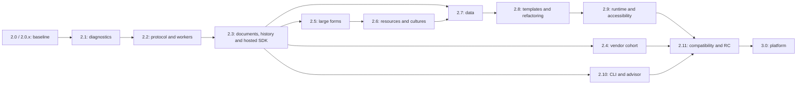

# Detailed roadmap: 2.0.0 → 3.0.0

**Planning date:** 22 September 2026.  
**Revised:** 23 October 2026 — the former 2.3.0 and 2.4.0 scopes are combined into one 2.3.0 release and every later minor moves one version earlier; task IDs are unchanged. See [the revision record](#roadmap-revision-2026-10-23).  
**Status:** 2.1.0 and 2.2.0 are implemented, locally verified and packaged. Later milestones use the status recorded in their release sections. Public distribution remains a separate gate.<br>
**Product:** WinForms Designer for VS Code.  
**Horizon:** from the bounded, scenario-verified 2.0.0 core to the extensible 3.0.0 platform with published compatibility contracts.

This document defines the release outcomes, the order of work and the acceptance criteria. Version numbers are not a calendar promise. A described capability becomes supported only after it is implemented, verified on the declared matrix and reflected in the support documentation.

The 1.0.0–2.0.0 history is kept in the [main roadmap](../ROADMAP.md). The details of the previous program are in the [2.0.0 plan](roadmap-v2.0.0-implementation-plan.md), and its results are in the [record of 26 August 2026](release-2.0.0-gate-record.md). This new document continues the program and refines the order of the remaining work.

## Contents

- [1. The baseline we start from](#baseline)
- [2. What the user should get in 3.0.0](#vision)
- [3. Release map and dependencies](#release-map)
- [4. Detailed releases](#milestones)
- [5. Architecture and standing engineering tracks](#architecture)
- [6. Support and acceptance matrix](#acceptance)
- [7. Separate research and program boundaries](#research)
- [8. Resources, execution order and plan revision](#execution)
- [9. The first 90 days](#first-90-days)
- [10. Sources and technical entry points](#sources)

<a id="baseline"></a>

## 1. The baseline we start from

### 1.1. Confirmed repository state

At the time this plan was prepared, `extension/package.json:6` sets the version to `2.0.0` and `extension/package.json:8` sets `preview: false`. The modern engine targets `net10.0-windows`; the Framework engine targets `net48` with `PlatformTarget=x64`. These values describe the sources and the packaging; on their own they do not confirm publication or full compatibility with Visual Studio.

The current [scenario catalog](v2/vs-parity-scenario-catalog.tsv) contains 128 rows: 111 repository `PASS`, 12 `NOT_EXECUTED`, 5 `GATED`; separately it records 40 reference `PASS` and 88 reference `NOT_EXECUTED`. This is a recount of the recorded statuses, not a new test run. `HARNESS_ONLY` is a separate automation attribute: 11 such rows must not be added to the number of product checks.

The August gate record is a historical snapshot. In particular, its statements about a dirty tree and HEAD at `v1.9.0` must not be carried over to the current branch: before the documentation was changed the working tree was clean and HEAD was `72a4ee3`, with no tag directly on HEAD. Publication to Marketplace/Open VSX was not checked while the roadmap was being prepared.

| Area | What already exists | What remains the subject of 2.x |
|---|---|---|
| Core loop | Real render/select/edit/save, geometry, tree, toolbox, properties, events, collections, menus and the component tray | A broader corpus of forms, uniform command behavior and measurable speed |
| Sources | Minimal edits, ownership and revision checks, refusal on an ambiguous write | Extending the supported forms of writing without losing user code |
| Resources | `.resx`, images, localization, RTL, structural operations in the neutral language for a bounded set of cases | Culture overview, bulk operations, complex resource dependencies |
| Documents | Snapshot/PatchSet/journal, compensation, Save As, bounded hot-exit recovery | Long history, several linked artifacts, real upgrades and rollbacks |
| Runtime | Working modern/net48 processes, reuse, crash recovery, build coordination | Connecting the shared supervisor to ordinary traffic; a multi-project policy |
| Protocol v2 | Schema and verifiable bindings, a diagnostic probe | Ordinary render/describe/edit requests through the versioned contract |
| Hosted services | Real but narrow repository-certified scenarios for smart tags, editors and adorners | More contracts, a real SDK, independent adapters and vendor cohorts |
| Adapter manifests | Product discovery is already wired into `activate`; metadata and diagnostics are produced | A verified loader, activation, trust revocation, compatibility of executable adapters |
| Migration | Real migration of toolbox state from global to workspace; separately, the experimental `v2Migration.ts` contract | An inventory of the formats actually persisted, upgrade/rollback verification and migration of only the necessary changes |
| Headless | Development CLI and test benches | Validating real projects through the same product planners and engines |
| Quality | Unit, webview, named-pipe, Extension Host, reference traces and VSIX checks | Broader direct evidence, real ARM64/AT/vendor checks and long-running runs |

Three constraints particularly affect the order of work:

1. `WorkerSupervisor` currently serves the diagnostic probe; the existence of the class does not yet mean that it manages all designer sessions.
2. `V2AdapterManifestRegistry` is already called from activation, but it deliberately does not load an assembly, execute vendor code or grant the right to modify the project.
3. The existing recovery, editors, resources and binding do not need to be implemented again: new releases widen their boundaries and unify the existing paths.

### 1.2. Standing product rules

- Opening a form does not rewrite the project or normalize the code.
- Each command changes only the declared artifacts; a conflict preserves the user's external changes.
- A supported mutating command has one logical Undo/Redo boundary for all affected artifacts. Binding to native history, focus and an open text editor is verified for every declared scenario; a single arbitrary stack across different editor types is not assumed.
- An unsupported scenario gets a clear reason and a recovery action before any file is changed.
- Sources and resources remain the source of truth; the cache and the preview can be recreated.
- The states “verified in a test”, “works in the product”, “compared with Visual Studio” and “verified on a device” are tracked separately.
- Loading project and vendor assemblies executes trusted code. Process isolation is responsible for lifecycle management and recovery; additional restrictions require separate proof.
- 2.x updates preserve the declared user scenarios. Possible incompatible changes to public contracts are announced in advance and prepared for the 3.0.0 boundary.

<a id="vision"></a>

## 2. What the user should get in 3.0.0

**3.0.0 is an everyday WinForms designer inside VS Code for explicitly listed standard, custom and certified third-party controls, with safe editing, extensions and automated project validation.**

### Application developer

Opens a solution, picks a form, adds controls, edits layout, events, data and cultures, uses the supported smart tags and editors, saves and builds the project. When moving between VS Code and Visual Studio in a declared scenario, the semantics of the form and the unrelated parts of the files are preserved. A designer worker crash does not destroy unsaved work.

### Author of a custom control library

Plugs in the documented SDK, declares exact capabilities and dependencies, checks the adapter with a local conformance runner and gets targeted errors. A simple control without a special designer does not need the SDK. The behavior of modern .NET designers and net48 designers is described by separate contracts.

### Team maintaining a large application

Has a reproducible support matrix, reports on form problems, a compatibility check when libraries are upgraded and understandable recovery. Diagnostics do not require publishing the source project. CI can check the structure and, on a suitable Windows runner, real loading and render.

### How reaching the goal is measured

- A key supported workflow completes without mandatory manual fixing of generated code.
- Changes are verified by the component graph, file semantics, the expected diff and Undo/Redo, not by a single screenshot.
- Certification always names the library, version, runtime, architecture and the list of verified capabilities.
- The team sees which limitations were found before a runtime or vendor suite upgrade.
- No feature is included in 3.0.0 merely for the version number: a contract, a product path, tests, documentation and a recovery scenario are mandatory.

<a id="release-map"></a>

## 3. Release map and dependencies

Completed milestones are identified by their acceptance records; later rows remain planned until their own release section records acceptance. The 2.0.x patch branch accompanies the main work and does not delay fixes for data loss or critical regressions.

| Version | Main outcome | Key dependency | Condition for moving on |
|---|---|---|---|
| **2.0.0 / 2.0.x** | A fixed baseline and an up-to-date map of limitations | The current core | Historical and current evidence are separated, critical defects are closed |
| **2.1.0** | Predictable compatibility diagnostics and recovery of the working environment | The 2.0 baseline | The user understands a refusal and can restore the session |
| **2.2.0** | **Accepted locally:** a shared protocol and supervisor on real commands; [evidence](release-2.2.0.md) | 2.1 + characterization | 28/28 product scenarios on both hosts; installed upgrade/downgrade verified |
| **2.3.0** | **Accepted locally:** documents, linked changes and a reliable hot exit; hosted services and Adapter SDK Preview; [evidence](release-2.3.0.md) | 2.2 | Crash/restart/undo are verified for the declared complex transactions; an independent sample uses the published contract; one complete acceptance of the final tree covers both scopes |
| **2.4.0** | The first real vendor cohort and useful editors | 2.3 + vendor access | Exact certification of one available set of versions |
| **2.5.0** | Fast work with large and nested forms | 2.2–2.3 | Fixed performance budgets on the real product |
| **2.6.0** | Resources, cultures and visual localization checks | 2.3 + 2.5 | Linked resource edits and RTL are verified without losing fallback |
| **2.7.0** | Complete applied data-binding scenarios | 2.3 + 2.6 for localized forms | Build and runtime check of a form with a changed model |
| **2.8.0** | Reusable forms, templates and refactorings | 2.3 + 2.6–2.7 | Re-applying and undoing do not damage the project |
| **2.9.0** | Verified accessibility and an extended runtime matrix | Accumulated UI/runtime features + the lab | Real AT, DPI and hardware checks of the declared set |
| **2.10.0** | Product CLI, project validation and design advisor | 2.2–2.3 + the relevant capabilities | The CLI calls real product paths and produces a reproducible report |
| **2.11.0** | Contract freeze, SDK RC and a transition rehearsal | All mandatory tracks | Beta/RC evidence, migration and rollback are ready |
| **3.0.0** | A stable extensible platform | 2.11 + independent acceptance | All mandatory capabilities of the declared matrix are accepted |



The arrows denote implementation dependencies, not a need to wait for the whole preceding branch to ship. Research, the accessibility audit, hardware checks and the preparation of vendor fixtures start with 2.1; the corresponding numbers mark the moment the result is consolidated. Independent features can be developed in parallel once the shared contracts have stabilized.

The vendor cohort is a separate input to the final acceptance. Its unavailability does not delay managed performance, accessibility and runtime checks; vendor-specific legs are counted separately. Release numbers denote a target sequence that can be revised while keeping the task IDs and the history of the move.

### 3.1. Mandatory core and managed scope

The 120 tasks form the full proposed backlog. A `PLANNED` mark is not a commitment to implement every extension before 3.0. Before a minor release starts, its mandatory tasks, research decisions and candidates are fixed; after a failed test this classification must not be changed merely to get a green report.

| Class | Contents | Execution rule |
|---|---|---|
| Mandatory core | Preservation of existing workflows, product protocol/lifecycle, document and recovery in the proven scope, SDK 1.0, the first vendor cohort, the declared CLI and support matrix | The basis of R30-01–R30-08; a reduction requires an explicit revision of the program goal |
| Candidate extensions | A wider Lane B (R24-08), virtualization when the need is confirmed (R26-03), pseudo-localization/visual comparison (R27-05/06), extended master-detail/settings bindings (R28-04/08), Extract UserControl and cross-project transfer (R29-03/05) | Included after an assessment of the benefit, a technical probe and the available capacity; a postponement does not weaken the checks of already supported features |
| Research with a decision | Shared custom/text history and restoring the redo branch (part of R23), modern designer ABI (part of R24), Tier D and the OS sandbox | The result of the research is a proven model or an explicit limitation; an impossible option does not become a hidden mandatory dependency |

The acceptance scenarios in section 4 describe the full target variant of each release. If a candidate is not included, a narrower scenario with the same integrity requirements is published before acceptance starts. Basic templates, the existing data binding and localization remain in the mandatory regression matrix regardless of what happens to the additional features.

<a id="roadmap-revision-2026-10-23"></a>

### 3.2. Revision of 23 October 2026: 2.3.0 and 2.4.0 combined

**Reason:** 2.3.0 was accepted locally on 22 October 2026 but was not published. The 2.4.0 scope was then implemented in the same unpublished working tree over `b7717b4`. The two scopes ship as one release, closed by one complete acceptance of the final tree, instead of separating the tree to publish an intermediate version.

| Scope | Task IDs | Before the revision | After the revision |
|---|---|---|---|
| Documents, history and recovery | R23-01–R23-12 | 2.3.0 | **2.3.0** |
| Hosted services and Adapter SDK Preview | R24-01–R24-09 | 2.4.0 | **2.3.0** |
| The first vendor cohort and extended editors | R25-01–R25-08 | 2.5.0 | **2.4.0** |
| Large forms, precise layout and responsiveness | R26-01–R26-09 | 2.6.0 | **2.5.0** |
| Resources, cultures and localized forms | R27-01–R27-09 | 2.7.0 | **2.6.0** |
| Applied data-binding scenarios | R28-01–R28-09 | 2.8.0 | **2.7.0** |
| Templates, reuse and safe refactorings | R29-01–R29-08 | 2.9.0 | **2.8.0** |
| Accessibility and a confirmed runtime matrix | R210-01–R210-09 | 2.10.0 | **2.9.0** |
| Product CLI, solution validation and design advisor | R211-01–R211-09 | 2.11.0 | **2.10.0** |
| Contract freeze and transition preparation | R212-01–R212-09 | 2.12.0 | **2.11.0** |
| A stable extensible platform | R30-01–R30-08 | 3.0.0 | 3.0.0 |

**Rules of the move:**

- Task IDs keep their original prefix. The number in an ID names the task, not the release: R25-03 is delivered in 2.4.0, and R212-09 is delivered in 2.11.0. Evidence, test scenarios and release records that cite these IDs remain valid references.
- No task is added, removed or narrowed. Acceptance criteria, budgets and gates are unchanged; only the version that consolidates them moves. 2.12.0 is no longer planned, and 3.0.0 stays the target.
- The 22 October 2026 local acceptance of the document scope was taken on an intermediate tree. It remains a historical record and does not close the combined release.
- The combined 2.3.0 is closed by one acceptance run of the final tree: every executable CI step, both frozen VSIX packages and artifact-bound evidence for R23 and R24 together. The product version, package identities, the Adapter SDK Preview product cohort, the changelog and the release records move from 2.4.0 to 2.3.0 as part of that closure. The cohort is declared in the sample packages and their tests, so this is a product change and not a documentation rename.
- The record that was prepared for the former 2.5.0 becomes the 2.4.0 record.

<a id="milestones"></a>

## 4. Detailed releases

### 2.0.0 / 2.0.x — fix the baseline and maintain it

**Value:** the user gets a stable starting point; the team understands what can be extended without redoing work that is already complete.

**Work items:**

- [ ] **R20-01. Product route map.** For every capability, record the UI entry point, extension command, engine RPC, planner, transaction, reconciliation and a direct test. Mark helper-only, diagnostics-only and metadata-only paths separately.
- [ ] **R20-02. An up-to-date appendix to the baseline.** Reconcile the code, the catalog, the README and the support matrix. Fix outdated current statements while keeping historical gate records with their own date and evidence identity.
- [ ] **R20-03. Regression set.** Select fast mandatory scenarios: open/no-op save, property, geometry, resource, event, undo, external conflict, failed render, worker crash, net48 rebuild.
- [ ] **R20-04. Maintenance.** Patch releases include fixes for data loss, hangs, false compatibility and breakage of existing workflows. New capabilities ship in separate minor releases.
- [ ] **R20-05. Artifact card.** At each real build, save the source identity, tool versions, runtime, architecture, VSIX hash and the list of checks performed. Publication is tracked separately.

**Proof of readiness:** a reproducible set of baseline scenarios is known, every declared capability is tied to a product route, and the package version is not used as proof of quality or publication.

**Do not redo:** building the existing source editors, rollback, basic binding, localization and the tab workflow from scratch.

### 2.1.0 — diagnostics, compatibility and managed recovery

**Result as of 2 October 2026:** `IMPLEMENTED / VERIFIED LOCALLY`.

R21-01–R21-08 are closed. The same release included engine fixes for issues #6 and #7.

All evidence was retaken on the final code:
- 470 extension tests;
- 612 modern-engine tests and 50 net48 tests;
- two real Extension Host runs at 9/9 each;
- a 2.0 → 2.1 → 2.0 installation with real SQLite state, recovery of an unsaved form and Undo/Redo;
- checks of both VSIX packages.

The 2.0 base package was rebuilt from the source state `72a4ee3`; this is not a statement about a previously published VSIX.

The narrowings of the R21 wording are recorded explicitly in the “Limits of this evidence” section. The commands, boundaries and machine reports are listed in the [2.1.0 report](release-2.1.0.md).

**Value:** the user quickly understands why a form does not open completely, which library is required and what exactly recovery will do.

**Work items:**

- [x] **R21-01. Form status panel.** Show the resolved project/TFM, engine/runtime/architecture, the selected culture, the preview source, the last successful build and the limited capabilities. Details expand on demand.
- [x] **R21-02. A single catalog of reasons.** Link a refusal code to a specific object, property or assembly and to an action: rebuild, pick an assembly, go to the code, reset a corrupted cache or retry the render.
- [x] **R21-03. Bitness diagnostics.** Take into account the evaluated project configuration, `PlatformTarget`, `Prefer32Bit`, the PE architecture and native dependencies on both runtime branches. Distinguish “definitely x86”, “architecture unknown” and “unsupported ActiveX”.
- [x] **R21-04. An explicit COM request contract.** Wire in a named refusal for toolbox/API requests so that the lack of support does not depend only on a hidden webview tab. Keep the existing source-level ActiveX gate.
- [x] **R21-05. Adapter manifest diagnostics.** Build on the registry that is already wired in: explain an incompatible version range and runtime, duplicates and invalid capabilities. An accepted manifest must not look like an activated executable adapter.
- [x] **R21-06. Environment recovery.** The commands that rebuild the cache, rediscover controls and restart the worker show the expected result; user files and unsaved documents are preserved.
- [x] **R21-07. Real settings migration.** Inventory the existing configuration, global/workspace mementos, toolbox cache, journal and backup: producer, consumer, version, lifecycle. Keep the working toolbox scope migration. Change a format only when the product needs it; reuse `v2Migration` after checking that it is fit for purpose rather than creating a new cache just to wire in a helper. Verify the states actually released, corruption, an unfinished upgrade and a return to the chosen supported version.
- [x] **R21-08. A reproducible diagnostic bundle.** Versions, capability decisions, timings and correlation IDs are exported with a size limit and with private paths/data scrubbed; sources are attached only by a separate deliberate action.

**Acceptance:** the product Extension Host opens a healthy, a partially supported and a faulty form; shows different reasons; performs the corresponding recovery; preserves the document state. An old installation is really upgraded and rolled back, rather than only passing a JSON helper test.

User settings, a rebuildable cache and the only copy of unsaved data follow different rules. On a downgrade, the old build must not destroy an unknown backup/history format: before switching there must be a compatible backup or an explicitly saved copy of the data with a verified restore. The cache-clearing command does not delete recovery data.

**Dependencies:** the 2.0 baseline, `tierDCompatibility`, the project resolver, the registry, diagnostics and migration. x86 diagnostics do not include support for running an x86 worker.

### 2.2.0 — working protocol and process management

**Status: accepted locally on 2026-10-08.** All R22-01–R22-08 are closed against the archived 2.2.0 artifacts. Ordinary product acceptance passed 28/28 scenarios on VS Code 1.84.0 and 1.141.0; installed 2.1.0 → 2.2.0 → 2.1.0 passed three workbench phases and nine persistence/recovery checks on each host. See the [release record, package hashes and evidence limits](release-2.2.0.md). Publication and physical ARM64 acceptance retain their separate gates.

**Value:** fast actions, switching forms, cancellation and a library failure do not lead to a late preview, a hung session or someone else's reply in the active document.

**Work items:**

- [x] **R22-01. Characterization before extracting modules.** Record the DTOs, error codes, geometry, minimal diff and Undo of the existing traffic. Extract session/commands/render/lifecycle in small changes.
- [x] **R22-02. Version negotiation.** The real extension and engines negotiate the protocol range, capabilities and binary build identity. The wire protocol number is versioned independently of the extension's SemVer.
- [x] **R22-03. Render/describe through the envelope.** Move opening, render, hit-test/selection metadata and property describe to session/document/request IDs, revision/generation, deadline and cancellation.
- [x] **R22-04. Mutations through the same contract.** Move property, geometry, structural, events and resource intents. Before the switch, define a stable operation ID separate from the request attempt ID, a payload fingerprint and a commit-outcome record held by the single host commit owner on top of the existing journal. Repeating an operation returns the established result without a second diff/Undo; the same ID with a different payload is rejected. An unknown outcome after a crash is first resolved from the journal and the actual baselines. This minimal mechanism is part of 2.2 and is not deferred to the general history of 2.3.
- [x] **R22-05. Connect the supervisor to the product.** Move ownership of ordinary workers from the diagnostic proof into the real lifecycle, keeping the already working lazy start, warm reuse, idle exit and rebuild release.
- [x] **R22-06. Worker identity.** Fix the effective owner project/configuration/TFM/platform and the dependency fingerprint on top of the existing resolver. Define keys of runtime × architecture × dependency graph × trust policy. Sessions of incompatible projects do not accidentally reuse one graph; the number of resident processes is limited by a setting and a budget.
- [x] **R22-07. Quotas and backpressure.** Limit the queue, payload size, execution time, memory and handle growth. Metadata/render requests may be coalesced; mutating commands must not be lost under throttling.
- [x] **R22-08. Partial update and recovery.** Verify mismatched extension/engine versions, a missing payload, a late reply after a recycle, a repeated crash and cancellation while the document is closing. A damaged installation produces a recovery action.

**Rollout order:** read-only requests → the source of patch proposals → the remaining mutations → lifecycle ownership. During the transition an adapter to the previous transport is allowed; one command always has one owner and one write path.

The retry boundary is fixed before the migration: the retention period of operation records, restart, closing the document, a new revision and journal cleanup. A vendor callback with an unknown outcome is not retried automatically: the absence of a second workspace diff does not rule out external effects of the code. A legacy peer without the required contract uses a state check and an explicit refusal of automatic retry. When switching to the previous route, in-flight commands are completed or recovered first; their IDs and journal are not discarded.

**Acceptance:** drag/property/resource/save/rebuild/crash run through the real supervisor on modern and net48. The diagnostic probe does not replace these checks. The tests artificially reorder replies, cancel requests, kill the worker and open two incompatible projects.

**Rollback:** stop accepting new operations, complete or recover/compensate the pending transactions, preserve dirty buffers and backups, invalidate the previous generations and release worker ownership; only then enable the previous route. With an undetermined outcome the switch waits for reconciliation and does not create a second commit owner. Restarting the Extension Host is acceptable as a documented condition. Verify the rollback during a pending edit and after a journal write, not only on an idle form. Before it is enabled by default, the new branch is no worse than the baseline in correctness and in the established latencies.

### 2.3.0 — documents, history, recovery, hosted services and Adapter SDK Preview

**Status: accepted locally on 2026-10-27.** Since the [23 October 2026 revision](#roadmap-revision-2026-10-23) this release also contains the former 2.4.0 scope. One complete acceptance of the final tree passed all 45 executable CI steps and covers R23-01–R23-12 and R24-01–R24-09 together, within the documented public API, ownership and Preview boundaries; the earlier document-scope acceptance of 2026-10-22 was taken on an intermediate tree and is superseded. See the [release record and artifact-bound evidence](release-2.3.0.md). Publication, physical ARM64 and licensed vendor qualification remain separate gates.

#### Documents, history and recovery

**Value:** several designer actions and linked files survive closing the window, restarting VS Code and an external edit without losing work.

**Work items:**

- [x] **R23-01. Full document ownership.** Separate on-disk bytes, unsaved editor buffers, the durable journal and the transient preview. Separately define several CustomEditor views of one document and coexistence with the standard TextDocument: a shared data source does not mean a shared native Undo stack. Before extending, run a technical probe on the public API and on the minimum/current VS Code.
- [x] **R23-02. All writers in a shared transaction.** Bring property, geometry, events, source/resource/project edits under one orchestration contract on top of the existing PatchSet and journal.
- [x] **R23-03. Several Undo steps after hot exit.** After the technical probe, extend the proven single scenario to a bounded history, for example 20 operations. Serialize verifiable changes and checkpoints, not callbacks. Separately verify undo of applied operations, a new redo after undo and restoring a redo branch that already existed before exit. The last scenario is enabled only if support by the public API is proven; otherwise a limitation is published and the last document state is preserved.
- [x] **R23-04. Multi-file recovery.** Work through creating an event handler, localized control add/delete, image import and Save As with linked artifacts. The journal must distinguish applied, compensated and requiring a manual decision.
- [x] **R23-05. External change UX.** On an external change, show the affected files and safe options: reload, save the current work under another name, open a diff. Automatic compensation does not overwrite someone else's bytes.
- [x] **R23-06. Save As and path moves.** Verify collision, changed file paths, Windows casing, open buffers, linked cultures and project membership for the supported Save As. Describe explicitly whether generated names/namespace are kept or transformed; general semantic rename is connected to this recovery contract in 2.8 (R29-04).
- [x] **R23-07. Recovery timeline.** Show the latest operations, the failure and the available restore point without automatically exposing sources in diagnostic logs.
- [x] **R23-08. Crash injection.** Cover a stop after prepare, after each write, after Undo registration and after commit; separately, a read-only file, lack of disk space, cancellation and a change to the file by another process.

**Field findings from 2.2.0.** On 12 October 2026 an installed 2.2.0 opened a real solution of two single-target `net48` projects with a shared source tree: one project includes the files through explicit `<Compile Include … Link>` items, the other imports the same directory as a `.projitems`. The tasks below are unrelated to the document-and-history theme; they are included in 2.3.0 as maintenance of already declared workflows and, if moved, remain visible under their IDs.

- [x] **R23-09. Choosing the project context for a file with several owners.** Today `ResolveDesignerDocumentOwner` picks the owner itself only where the choice does not affect the render: all contenders provably go to the modern engine. If at least one contender is `net4x`, multi-target or declares its TFM outside its own project file, the result remains `AMBIGUOUS_OWNER`: the form does not open and the product offers no action. The gate's concern is justified: in the solution found, the owners have different `DefineConstants` and the compiled binaries can differ, so no automatic choice is added. Instead: on a refusal with a list of owners, the host offers a choice of project; the chosen project goes through the same file-membership check in the engine again; the choice is remembered for the document in workspace state and changed by a separate command; cancelling leaves the previous refusal. The chosen owner determines the net48 binary for the preview and the source tree for events. A stale choice, where the project no longer compiles the file, is not applied silently. For `AMBIGUOUS_OWNER`, the R21-02 catalog of reasons gets the choice action instead of the general advice to resolve the ambiguity. The task is a narrow early slice of R29-06: choosing configuration/TFM/platform and moving between projects stay there. The change touches the pre-render gate and requires new tests: engine unit tests and an Extension Host test on the existing `OwnerAmbiguous` fixture.
- [x] **R23-10. Toolbox auto-discovery budget.** On the same solution the pass finished with `controls=0; truncated=true` although the project compiles its own controls. There are three causes. First: the roots `bin`, `bin\Debug` and `bin\Release` are nested in one another and deduplication is done only by root, so every directory is walked twice and spends the file budget: 29 directories and 396 files skipped by the budget for 77 DLLs in the output. Second: the reflection limit of 24 assemblies is applied in alphabetical order, and on this output it is taken up entirely by native and third-party libraries without WinForms controls. Third: only `*.dll` files are candidates, so the own output of a project with `OutputType=Exe` does not enter the pass; before changing this, check whether another route covers it. Work: deduplicate directories across nested roots; before spending the reflection budget, cheaply filter out candidates that are certainly empty, for example non-managed PE files and satellite `*.resources.dll`; check the output of the owner and of its `ProjectReference` items first, then the rest; decide and record the behavior for `.exe`. The budgets stay bounded, and the log names the checked and the skipped assemblies so that a truncated result is explainable. Tests: unit tests for nested roots and for an output whose alphabetically first assemblies contain no controls.
- [x] **R23-11. MSBuild evaluation with a pinned old SDK.** The solution's `global.json` pins an SDK whose MSBuild is older than 17.8 and does not know `-getProperty`; the evaluation ends with `MSB1001` and exit code 1. The engine correctly falls back to searching `bin`, so the render is not affected, but the failed launch repeats after the 10-second negative TTL and writes a log line each time. For a single-target `net4x` project the evaluation result is discarded anyway as not loadable in the modern host. Work: do not launch the evaluation when the project's own file unambiguously declares a single-target Framework TFM; remember the “switch not supported” outcome per project and SDK version rather than for 10 seconds; show the reason once as a named item of the R21-01 status panel instead of a raw log line. A separate evidence-backed decision: whether a way to obtain `TargetPath` on an old MSBuild is needed for modern projects with a pinned SDK, or the documented fallback is enough.
- [x] **R23-12. Worker exit reason in the log.** When a second document was opened, the log showed `[engine] exited null` with no reason. The `null` code alone does not establish the cause: the log did not identify a requested host termination or an abnormal worker exit, and the lifecycle route was not established during the analysis. Work: establish the route; write the exit reason to the log (idle exit, release after a build, recycle, generation replacement) and distinguish it from an abnormal exit; use the same reasons in the R21-08 diagnostic bundle.

**Acceptance:** two real VS Code launches restore several actions and several artifacts on both engines; save and undo produce the expected hashes. The history length limit and the behavior when the limit is exceeded are documented.

**Acceptance of the field findings:** the Extension Host opens a file that two `net48` projects compile: without a choice, a named refusal with an action; after a choice, a preview from the chosen project's binary; after a cancel and with a stale choice, a refusal again. Auto-discovery on an output with nested roots and more than 24 assemblies finds the project's controls or names the assemblies it did not check. A project whose `global.json` pins an old SDK opens without repeated failed MSBuild launches, and a worker terminated by the host itself is distinguishable in the log from a crash.

**Early technical probe:** dirty and clean checkpoint, Save/Save All/auto-save in the middle of the history, closing with a non-empty redo branch, switching focus between designer/code, external and interleaved manual edits, a partial Undo failure, two different documents and two CustomEditor views of one document. On a negative result the baseline commitment is recovery of the data and of the proven set of logical transactions; shared native history and additional views remain explicitly limited. A private workbench API is not used as a workaround. The history size and the updated acceptance scenario are fixed before a broad recovery UI is developed.

**Technical boundary:** a backup restores data; arbitrary process objects, delegates and serialized vendor graphs do not become a document format. The behavior is checked against the [VS Code Custom Editor API](https://code.visualstudio.com/api/extension-guides/custom-editors), including the extension's own responsibility for backup and editable custom documents.

#### Hosted services and Adapter SDK Preview (former 2.4.0 scope)

**Value:** a library developer can add special designer commands and editors through a reproducible public contract.

**Work items:**

- [x] **R24-01. Registry of service contracts.** For container/siting, selection, component change, naming, command, toolbox, type resolution and serialization, define the methods, STA/lifetime, cancellation, reentrancy and refusal behavior.
- [x] **R24-02. Extend the existing kernel.** Add services one at a time on modern/net48 with a real call from the UI. A non-null `IDesignerHost` is not considered sufficient proof of completeness.
- [x] **R24-03. SDK 0.x.** Provide the schema, typed intents/results, capability declaration, package layout, a sample adapter, a host compatibility matrix and a diagnostics guide. Preview incompatibilities are marked by the SDK version and migration notes.
- [x] **R24-04. A loader on top of the registry.** Verify the real files, hashes, signature/provenance under the chosen policy, product cohort and trust settings before loading. The string `signed-vendor` in JSON does not grant execution rights.
- [x] **R24-05. Trusted development mode.** The author of their own adapter can explicitly enable local development without a claim of vendor certification. The mode is isolated from the certified product matrix.
- [x] **R24-06. Editors broker.** Extend the supported modal/dropdown editors: native window ownership, focus, Escape/Cancel, timeout, nested invocation, and the type and invariant representation of the result.
- [x] **R24-07. Adorners and smart tags.** Describe stable hit targets, a keyboard alternative, disabled reasons and the route of a command into a source transaction. A render-only embellishment does not get write authority.
- [x] **R24-08. Lane B by proven operation types.** Extend owned-region serialization only for cases with independent postconditions; unknown statements, resources, encoding and user partials are preserved.
- [x] **R24-09. Conformance runner.** An independent sample is built outside the extension sources and passes success/refusal/cancel/undo/restart without private test hooks.

**Acceptance:** two sample adapters demonstrate different contracts: a designer action and a property editor. An incomplete service, a modified assembly, a wrong result type and revoked enablement are blocked before mutation. The exact list of SDK Preview capabilities is published.

**Before the SDK Preview is fixed:** verify one real modern designer/editor on `Microsoft.WinForms.Designer.SDK` and a separate classic sample on `System.Design`. Record the assembly/API identities, the required services and the native UI boundary. The probe answers whether direct integration is possible or an explicit adapter is needed; the project's own SDK sample does not prove compatibility of existing vendor binaries. If undocumented VS/DesignToolsServer protocols or unconfirmed redistributable binaries are required, that option is rejected under ADR 0003. The decision is made before the first vendor cohort is promised.

**Dependencies:** the product supervisor, a single command authority, migration and transaction recovery. Modern designers and net48 designers are verified separately: the official [WinForms design-time API](https://learn.microsoft.com/en-us/dotnet/desktop/winforms/controls-design/designer-differences-framework) model distinguishes their namespaces and the interaction of the editor UI.

#### Closing the combined release

**Acceptance of the combined release:** R23 and R24 are accepted together on one final tree. Every executable CI step passes, both VSIX packages are frozen, and the evidence of both scopes is bound to their hashes. A result taken on an earlier tree, including the 22 October 2026 document-scope acceptance, does not substitute for this run. The fixed performance budgets are not relaxed to close the release; a budget failure stays blocking until a complete run on the supported hosts passes.

### 2.4.0 — the first vendor cohort and extended editors

**Value:** the developer of a real application knows which capabilities of a specific library version work and uses its main designer tools.

**Work items:**

- [ ] **R25-01. Choose the cohort by availability.** The first candidate is DevExpress, because the repository has a sample and integration experience. The choice of the exact version depends on the licensed artifacts available; it is not considered made in advance.
- [ ] **R25-02. Certification passport.** Record the product/version, assembly hashes, .NET/architecture, required services, editor types, known exceptions and the version of the reference environment.
- [ ] **R25-03. Main user path.** Open a form with vendor controls; select and change standard and special properties; run an action list; edit a supported collection; save/undo/reopen/build.
- [ ] **R25-04. Applied editors.** Choose the collections in demand: grid columns, tab pages, menu items or layout items. For each, describe the identity of the elements, names, references, ordering and preservation of unknown properties.
- [ ] **R25-05. Coexistence of versions.** Two projects with different versions of one suite work without the assembly graph being substituted. Upgrading the library invalidates only the cache/certification decisions that relate to it.
- [ ] **R25-06. Vendor failure corpus.** Verify a hang, a converter/editor exception, an invalid result, a licensing failure and a native dependency mismatch. A failure of one editor does not cancel healthy documents.
- [ ] **R25-07. Cross-tool round trip.** Archive VS Code → Visual Studio → VS Code with the expected semantic/source/resource changes and a normal runtime build.
- [ ] **R25-08. Adapter management.** Enabling, disabling, upgrading and returning to the previous version preserve the document and give a clear compatibility status.

**Acceptance:** at least one exact cohort has a complete passport and passes the Tier C threshold. All mandatory scenarios and integrity checks pass in full. Other vendor versions remain generic/best effort or unsupported according to their actual capabilities.

**If the artifacts are unavailable:** ship the general editor improvements under an exact name and leave the certification item `GATED`. `FakeVendor` keeps its role as a test fixture and never substitutes for an independent vendor cohort.

### 2.5.0 — large forms, precise layout and responsiveness

**Value:** a form with hundreds of controls remains convenient for searching, selecting, editing and moving between nested containers.

**Work items:**

- [ ] **R26-01. A real performance corpus.** Fix the mandatory standard/custom-managed forms of 50/300/1000 controls: nested, data-bound and localizable. Measure the vendor corpus as a separate check when artifacts are available; its absence does not block the managed performance milestone and does not close vendor acceptance. State the number of layout nodes and the tree depth, not only the number of fields.
- [ ] **R26-02. Extend incremental updates.** Use the existing retained Text/leaf render as the starting point. Add proven invalidation kinds for property, geometry and container updates; an ambiguous case triggers a correct full render.
- [ ] **R26-03. Property grid and outline.** Introduce virtualization where profiling shows a benefit, keeping stable selection identity, search, expansion, keyboard navigation and the accessibility tree.
- [ ] **R26-04. Working with layout constraints.** Show the reasons geometry is unavailable: Dock, Anchor, AutoSize, TableLayoutPanel, FlowLayoutPanel, SplitContainer and inherited ownership. Offer the suitable container command.
- [ ] **R26-05. Bulk geometry.** Extend the existing alignment and multi-selection: equal spacing, distribution within a container, group resize and a meaningful preview under constraints. All targets are verified before the shared mutation.
- [ ] **R26-06. Navigating a complex form.** Search by name/type/text, jump from a property to a control, a container breadcrumb, finding a hidden or overlapped element and a temporary visual highlight without changing Visible/source.
- [ ] **R26-07. Dynamic metadata.** Invalidate the descriptor/cache on changes to dependent properties; a hung converter does not block the whole panel. Caching does not return a stale editor or dropdown.
- [ ] **R26-08. Several open forms.** Priority for the active session, stopping an unneeded render and limiting resident surfaces. Switching the active document does not lose selection, zoom or unsaved state.
- [ ] **R26-09. Measurements of the full action.** Separate input→feedback, command→commit, commit→authoritative render, cold open and warm open. The report includes samples, p50/p95, outliers and the reasons for a full render.

**Initial target budgets for calibration:**

| Operation | Target on the fixed machine and corpus | How to accept |
|---|---|---|
| Local canvas feedback | p95 ≤16.7 ms per frame at 60 Hz | Pointer/keyboard feedback; without requiring a full WinForms repaint every frame |
| Warm scalar commit, simple form | p95 ≤100 ms | From sending the intent to transaction confirmation |
| Warm scalar commit, 300 controls | p95 ≤250 ms | Commit and render are measured separately |
| Full scalar edit → authoritative canvas | The threshold for each corpus/runtime is approved on the pilot before the freeze | One operation ID from UI input to correct pixels/layout/properties; a fast commit without an updated preview does not count as a completed action |
| Warm open, 300 controls | p95 ≤3 s modern / ≤5 s net48 | Readiness of a correct canvas and properties |
| 1000 controls | Initially characterization; the threshold is approved after measurements | No hang, no lost commands and no unbounded memory growth |
| 500 open/edit/close cycles | Zero remaining owned processes after completion | Memory/GDI/USER are assessed after warm-up, taking the noise envelope into account |

These are **planned targets**, not the results of a current run. The previously recorded 300-control evidence and the existing `perf:baseline` do not replace this lab matrix. After the pilot, a target may be changed before acceptance starts, with an explicit justification and with the earlier measurements kept.

**Measurement protocol:** before acceptance, fix the OS/CPU/RAM/DPI, binary/toolchain versions, corpus, warm-up and timeouts. For p95 of actions and of opening: at least 100 measurements for every declared corpus/runtime/architecture combination, spread over at least three independent sessions; cold and warm are not mixed. Keep raw samples, failures, timeouts and the reasons for exclusions; slow results are not discarded to improve a percentile. Errors are assessed separately and cannot turn into a fast successful result. A short CI smoke does not substitute for this benchmark. For the leak trend, the warm-up, the sampling frequency and the acceptable noise envelope are fixed before the run.

**Acceptance:** reproducible before/after reports, no semantic/source regression and stable input at 1000 controls. An optimization does not disable postconditions, cancellation or source preservation.

### 2.6.0 — resources, cultures and checking localized forms

**Value:** the translator and the developer see the state of the resources as a whole, find lost translations and check long text/RTL before running the application.

**Work items:**

- [ ] **R27-01. Culture overview.** A table of neutral/parent/exact values, the presence of an override, the fallback source and the translation status. Search by control/property/resource key.
- [ ] **R27-02. Bulk resource operations.** Creating a culture, copying selected values, removing an override and resetting a group of properties go through one transaction with a view of the affected files.
- [ ] **R27-03. Resource dependency graph.** Show which forms and properties use an image/icon/string. Renaming a key updates only proven references; unknown expressions block the dangerous operation.
- [ ] **R27-04. Asset workflow.** Batch image import, duplicate detection by content, replacement that keeps references, and checks of size and transparency. The existing ImageList editor is extended without changing its identities.
- [ ] **R27-05. Pseudo-localization.** Temporary lengthening of text and highlighting of untranslated strings for the preview. Saving such a result is a separate explicit command, and ordinary toggling of the mode does not create a resource diff.
- [ ] **R27-06. Visual comparison.** Comparing a culture with neutral, text sizes and element positions at several DPRs. Warnings about possible clipping are advice, not a guarantee of a defect.
- [ ] **R27-07. Structural operations.** Extend add/delete/reparent in localizable forms, taking all culture resources into account. By default the structure changes in the neutral layer; exceptions require a separate contract.
- [ ] **R27-08. Inheritance and shared resources.** Separate a base-class resource from the override of a derived form; do not move ownership between them automatically.
- [ ] **R27-09. RTL acceptance.** Verify native RightToLeft/RightToLeftLayout, mirrored geometry, tab order, keyboard, menus and resource fallback on modern and net48.

**Acceptance:** a form with neutral, parent and exact cultures survives import, rename, structural edit, undo, restart and a cross-tool round trip. Unknown XML nodes, comments and opaque resources are preserved. Pseudo-localization without saving leaves the files exact.

**Dependencies:** multi-file transactions and correct geometry. External translation services are not a mandatory dependency of the release.

### 2.7.0 — applied data-binding scenarios

**Value:** the user creates and maintains a data-entry form or a data table, sees the bindings and can update them after the model changes.

**Work items:**

- [ ] **R28-01. A single overview of bindings.** Link the existing Data Sources, BindingSource, DataBindings, DataMember, formatting and update mode in one dependency view.
- [ ] **R28-02. Generating a form from selected fields.** Extend the existing scaffold commands: details, grid, labels, navigation and validation components by the user's explicit choice. The preview lists the names and files.
- [ ] **R28-03. Schema refresh.** After a POCO/typed DataSet changes, determine the renamed, removed and incompatible fields. Offer verifiable changes and keep the user's column settings.
- [ ] **R28-04. Master-detail.** Support bounded, explicitly declared BindingSource/DataMember relations; correctly create and remove the dependent components, labels and subscriptions.
- [ ] **R28-05. Formatting and validation.** Edit culture-sensitive formats, null display, value conversion and the supported ErrorProvider relations, keeping the existing literal/typed constraints.
- [ ] **R28-06. Design-time sample data.** Build a temporary deterministic sample from a locally described schema. The preview does not require a connection to a production database or saving test data into the application.
- [ ] **R28-07. Typed DataSet.** Extend the already existing generation to updating the model, with checks of the generated files, build and ownership. Provider-specific constructs remain separate capabilities.
- [ ] **R28-08. Application settings bindings.** Research and implement a bounded subset of bindings to settings with correct reset/default, type availability and preservation of project artifacts.
- [ ] **R28-09. Runtime smoke.** For every generated scenario, build a sample and verify the initial display, a value change and the behavior of formatting/update mode.

**Acceptance:** a developer creates a detail/grid workflow, changes the schema, updates the binding, undoes the update and builds the application again. An unsupported member or expression produces a refusal before the structural write.

**Boundary:** the designer does not become an ORM, a SQL editor, a credentials store or a database migration system. Such code remains the responsibility of the application and of specialized tools.

### 2.8.0 — templates, reuse and safe refactorings

**Value:** typical screens are created faster, and moving a group of controls or renaming a form does not turn into manual editing of many files.

**Work items:**

- [ ] **R29-01. Templates on top of scaffolding.** Extend the existing Form/UserControl creation: a local catalog of forms, sets of controls, starter layout/data patterns, a preview and parameter rules.
- [ ] **R29-02. Reusable snippets.** Save a group of controls with its dependencies: resources, BindingSource, ImageList, extenders, events. On insertion, recompute names and check type availability.
- [ ] **R29-03. Extract UserControl.** Implement a bounded command for a proven subtree. The plan includes source/resources/project membership, coordinate translation and a refusal when external references cannot be determined.
- [ ] **R29-04. Rename form/control.** Integrate with the available C# semantic rename and an independent check of references. When the language service is unavailable, show the exact limitation rather than applying a regex to the whole project.
- [ ] **R29-05. Transfer between projects.** Develop a dependency-aware clipboard: the target runtime, culture resources, assemblies, names and generated files are verified before mutation. Adding a package dependency requires a separate review of the specific change.
- [ ] **R29-06. Project context UX.** Extend the interface for choosing configuration/TFM/platform for linked and multi-target files and for transfer between projects. Use the effective context and the invalidation contract fixed in 2.1–2.2; preserve the user's deliberate choice.
- [ ] **R29-07. Inheritance workflow.** Creating a derived form, navigating to the base control, displaying protected/private ownership and updating after the base project changes.
- [ ] **R29-08. Change overview.** A large generation/refactoring shows the structure of the result, files, dependencies and a diff. The confirmation applies to a specific plan; a revision change requires replanning.

**Acceptance:** one sample goes through creation from a template → editing → extracting a UserControl → rename → transfer to another compatible project → undo/reopen/build. Re-applying does not create accidental duplicates or broken links.

**Boundary:** the available semantic services and the supported subset determine what the command can do. Fully automatic reworking of an arbitrary form is not claimed.

### 2.9.0 — accessibility and a confirmed runtime matrix

**Value:** support for different devices, DPI, keyboard and screen readers is confirmed by real user tasks.

**Work items:**

- [ ] **R210-01. Accessibility audit from the start of the program.** From 2.1 on, keep a list of barriers; here, consolidate the fixes for all new UI: property grid, dialogs, toolbox, outline, tray, smart tags, diff and recovery.
- [ ] **R210-02. Full keyboard workflow.** Open a form, find a control, change a property, invoke an editor, perform layout, switch culture, save and undo without a mouse. Do not allow focus traps.
- [ ] **R210-03. Assistive technology.** Real Narrator and NVDA on Windows: labels, roles, order, selection, expanded state, mixed values, validation and announcements. One screen reader does not substitute for checking the other.
- [ ] **R210-04. Scale and contrast.** Verify 200%/400% UI zoom, Windows text scaling, forced colors/high contrast, focus indicators and no reliance on color alone.
- [ ] **R210-05. Physical DPI.** Several monitors and DPR 1/1.25/1.5/1.75/2; moving the window, scaling, native editor positioning and hit testing. Logical coordinates are compared separately from pixels.
- [ ] **R210-06. ARM64 qualification.** Verify the native modern worker and, separately, net48 x64 compatibility, including packaging, install, custom/vendor dependencies, rebuild and recovery on a physical machine.
- [ ] **R210-07. Runtime lifecycle policy.** Review the supported TFMs and the minimum VS Code before every release candidate. Separate the application runtime, the bundled host runtime and the process architecture.
- [ ] **R210-08. Clean-machine checks.** Installing both VSIX packages on suitable clean Windows environments, with no accidental dependency on a development checkout or on assemblies installed on the developer's machine.
- [ ] **R210-09. Diagnostics of an unsupported environment.** State the specific reason: OS/runtime/architecture/native dependency/AT limitation, while keeping the ability to open the source code.

**Acceptance:** records of lab scenarios with the versions of the OS, hardware, VS Code, runtime and AT. Distinguish an automated DOM result, a native UI observation and hardware evidence.

**Dependencies:** the lab and the available devices are needed in advance. Basic accessibility is a condition of every preceding UI release; it must not be postponed to 2.9.

### 2.10.0 — product CLI, solution validation and design advisor

**Value:** the team finds form problems during review and in CI, and the developer gets targeted hints with a clear diff of the fix.

**Work items:**

- [ ] **R211-01. Product headless runner.** Rework the development CLI so that it discovers real projects/forms, resolves their context and calls the product planners/engines. An input JSON with a declared successful result is not a project check.
- [ ] **R211-02. Two modes.** Parse-only uses a separate static read of source/project metadata without MSBuild evaluation, restore, SDK resolvers, source generators, assembly loading or design-time code. Imports/conditions that cannot be determined remain `UNKNOWN/NOT_EXECUTED`; there is no automatic switch to an executing resolver. Trusted render/round-trip on a suitable Windows runner is enabled explicitly. The report says which mode was run and what remained unverified.
- [ ] **R211-03. A stable report contract.** JSON schema, exit codes, diagnostics with location/capability/runtime, format version, bounded logs and machine-readable `PASS/FAIL/GATED/NOT_EXECUTED`.
- [ ] **R211-04. Separate delivery of the CLI.** Define the package, runtime dependencies, updates and license composition. Change the current ban on including development bundles in the VSIX only together with a new release contract and a packaging check.
- [ ] **R211-05. Dependency upgrade check.** Compare the capability map before/after a chosen library/runtime change on a copy of the fixtures or in read-only mode; show new incompatibilities and the change in render/semantics.
- [ ] **R211-06. Advisor in Problems.** Rules for missing AccessibleName, a suspicious tab order, a localizable literal Text, possible clipping and unresolved resources. Separate a proven defect from a recommendation.
- [ ] **R211-07. Preview and apply fix.** Extend the existing product High-DPI preview/apply to the new rules. Fixes go through the ordinary intent→PatchSet→revision check→Undo. The remaining harness-only inspector/advisor scenarios are replaced with direct tests of ingress, UI and a real mutation/refusal.
- [ ] **R211-08. Baseline and suppressions.** The team stores agreed exceptions without masking new errors; stale suppressions are detected by stable diagnostic identity.
- [ ] **R211-09. Diagnostics for support.** An automatic minimal reproducible report without vendor binaries and user sources by default; sensitive-value canaries verify the real export path.

**Acceptance:** a clean Windows runner analyzes and renders a sample solution, finds a deliberately introduced defect, exits with the correct exit code and does not change project files. An advisor fix accepted by the user fixes the defect and is undone by a single Undo.

Parse-only separately passes a fixture with an executable project/toolchain hook: it is proven that the hook is not run, and a result that requires evaluation remains unknown. A productive general resolver is allowed only in trusted mode.

**Boundary:** a parse-only result does not mean that a control actually loaded or rendered. The generic automation API does not accept an arbitrary source patch from a client that bypasses the planner.

### 2.11.0 — contract freeze and transition preparation

**Value:** users and adapter authors can check the upgrade to 3.0 in advance, learn about incompatibilities and prepare a rollback.

**Work items:**

- [ ] **R212-01. Freeze the support matrix.** Fix the mandatory runtime/architecture/VS Code/vendor cohorts, scenarios and external acceptance legs. Every exception has a clear reason and an owner.
- [ ] **R212-02. SDK RC.** Release a candidate of the stable API with examples, a capability catalogue, an error taxonomy, a test harness and schema update rules. An independent adapter maintainer goes through the integration.
- [ ] **R212-03. Deprecation inventory.** List the deprecated commands, settings keys, adapter contracts and transport paths; show the replacement and the support period. Warnings must be targeted and fixable.
- [ ] **R212-04. Migration rehearsal.** Install the retained supported 2.x versions, create real settings/cache/backup, upgrade to the RC, open forms and roll back. Account for partially installed engines and an offline environment.
- [ ] **R212-05. Freeze document compatibility.** Confirm that projects do not need a new proprietary format. Changes to the internal cache must not automatically normalize `.Designer.cs`/`.resx`.
- [ ] **R212-06. Long-running tests.** At least 8 hours of product workload and 500 open/edit/close cycles for the declared profiles, including several workers, builds, resource edits, cancellation and recovery.
- [ ] **R212-07. Independent review.** Review the trusted execution boundary, input validation, loader provenance, project writes, diagnostics redaction, update/rollback and the whole matrix of critical scenarios.
- [ ] **R212-08. Beta cohorts.** Several representative projects with different owners: standard modern, classic net48, localized, large and certified vendor. Every blocker is assigned a decision, not an averaged score.
- [ ] **R212-09. Release runbook.** Describe the build, verification of immutable artifacts, publication, post-install smoke and returning to the previous package. The rehearsal is run without automatic public publication.

**Acceptance:** there is no open defect of data loss, false successful save or mixing of documents; the mandatory scenarios pass on the declared legs; migration/rollback are performed on real installations.

**Version policy:** 2.11.0 remains a compatible minor release. Incompatible changes of the future 3.0 are available only in a separate preview/RC channel and are not slipped into stable 2.x.

RC is a quality stage, not a package version string chosen in advance. Before publication, R212-09 fixes separate stable/pre-release sequences and verifies the transitions of both channels: Marketplace requires a numeric `major.minor.patch`, does not accept the SemVer suffix `-rc.1` and does not allow one version to be used for both pre-release and stable. Source: [Publishing Extensions — Pre-release extensions](https://code.visualstudio.com/api/working-with-extensions/publishing-extension#pre-release-extensions). Open VSX is checked separately; changing package/release-preflight is not part of preparing this roadmap.

### 3.0.0 — a stable extensible platform

**Value:** an application is maintained in VS Code on a known matrix, libraries extend the designer through a stable SDK, and the team validates forms automatically and manages upgrades predictably.

**Required outcomes:**

- [ ] **R30-01. A real platform path.** The declared UI/SDK/CLI mutations use the shared command/transaction contract and the product supervisor; diagnostic helpers do not pass themselves off as the implementation.
- [ ] **R30-02. SDK 1.0.** Contracts, package compatibility, migration examples and a conformance suite are published. Support for a specific adapter is confirmed by its real integration.
- [ ] **R30-03. The first certified vendor cohort.** At least one available, independently verified set exists; the exact versions and limitations are part of the release documentation.
- [ ] **R30-04. Everyday workflow.** Standard controls, project context, layout, properties/editors, resources/cultures, data binding, templates and recovery are accepted in the declared scope.
- [ ] **R30-05. Reliability and accessibility.** The agreed performance, long product runs, clean-machine, physical architecture, keyboard, AT and native DPI/culture tests are passed.
- [ ] **R30-06. Compatibility.** Supported 2.x projects open without migrating generated source. For a change in settings or the SDK, an upgrade path, diagnostics and a proven rollback are available.
- [ ] **R30-07. A confirmed release artifact.** The support matrix, evidence manifest, changelog and packages describe one set of sources. Publication and its smoke are recorded as a result of their own.
- [ ] **R30-08. Maintenance.** The runtime update policy, adapter API support, the procedure for fixing critical defects and servicing of the last stable 2.x during the transition period are published.

**Why a major version:** 3.0 fixes a stable platform/SDK contract after the preview period. If a deprecated public contract has to be removed, it is done here after the deprecation period. A major version does not require a mandatory change of the wire protocol and does not justify losing compatibility of user files.

**Final criterion:** all mandatory advertised capabilities pass their scenarios and the supported runtime/architecture legs; published exceptions do not hide the failure of a mandatory workflow. If vendor or hardware acceptance is unavailable, the milestone stays open or its scope is revised explicitly before the freeze, without declaring an unachieved result complete.

<a id="architecture"></a>

## 5. Architecture and standing engineering tracks

### 5.1. One route for a mutating command

The target chain for the canvas, property grid, smart tag, adapter and advisor:

```text
User intent
  → document/session identity + exact revisions
  → capability + ownership + runtime decision
  → deterministic PatchSet + independent postconditions
  → preview when the operation requires it
  → revalidate all affected source/resource/project baselines
  → commit or conflict-safe compensation
  → one logical transaction + verified native Undo/Redo integration
  → authoritative reconciliation + stale-reply rejection
```

Workers return typed results, not the right to write project files themselves. Caching, render acceleration and hosted services do not bypass this chain. The existing `byteLocal` and source-minimality checks remain as the last line of control.

### 5.2. Module boundaries

| Area | Target responsibility | Entry point in the existing code |
|---|---|---|
| Document | Buffers, identity, snapshots, backup, save and native history | `WinFormsDesignDocument`, `documentStore` |
| Session | Selection, active culture, transient state, capabilities, render generation | `DesignerSession` |
| Commands | Typed intents, planner selection, dependency/ownership validation | `designerEditor`, engine planners |
| Transactions | PatchSet, journal, commit, compensation, recovery | `transactionRunner`, resource coordinator |
| Project context | Owner project, evaluated configuration/TFM/platform, dependency invalidation | `ProjectResolver`, `csprojRef`, `solutionProjects` |
| Runtime | Worker identity, startup/reuse/recycle, quotas, crash/build coordination | `getEngine`, `WorkerSupervisor` |
| Protocol | Generated DTO, negotiation, cancellation, correlation and bounded results | `designer-protocol-v2.schema.json`, generated bindings |
| Design services | Certified services, editors, actions, adorners | `DesignerServiceKernel`, product brokers |
| Webview | Presentation of state, accessible input, minimal local feedback | `designer.js`, `panel.js`, `chooseItems.js` |

Module extraction serves specific releases. No separate multi-month rewrite of the product is planned before useful capabilities are delivered. A change of structure and a change of behavior are verified separately where possible.

### 5.3. Source and owned-region serialization

- **Lane A:** minimal source/resource adapters remain the standard path.
- **Lane B:** used only for a region that explicitly belongs to the designer and for a verified change of the component graph.
- For every new operation, the allowed diff, preservation of unknown statements/resources, encoding/BOM/EOL and ownership of user partials are fixed.
- Equivalence that cannot be determined means a refusal or the available Lane A, not a silent regeneration of the form.
- Extending Lane B is accompanied by cross-tool fixtures; changing the output format without a functional need is not a goal.

### 5.4. Contract compatibility

The extension SemVer, engine build identity, wire protocol, adapter SDK, manifest schema, report schema and internal cache/backup formats are versioned separately. For example, the presence of protocol version 2 already in 2.0.0 does not mean that release 3.0 must use protocol version 3.

For each boundary, the producer/consumer matrix, the minimum supported version, the reaction to future/unknown required fields, the upgrade/downgrade conditions and the deprecation period are published. N/N−1 compatibility is verified where it is promised, on real interacting binaries and states.

### 5.5. Runtime and dependencies

As of the planning date, Microsoft's official policy states the end of support for .NET 8 and .NET 9 as **10 November 2026** and for .NET 10 as **14 November 2028**. These dates determine the need to review the host/toolchain; they are not an automatic ban on opening a project with an old TFM. The policy is checked again before every RC. Source: [.NET Support Policy](https://dotnet.microsoft.com/en-us/platform/support/policy).

Target policy: the bundled modern host follows the chosen serviced branch; compatibility of the application's target frameworks is verified by a separate corpus. The next .NET version first goes through a preview matrix and is then added to support based on the results. net48 compatibility is kept as long as it is declared and passes its OS/architecture/vendor matrix.

Build/test/restore coordination takes code execution and output locks into account. Changing the application's `TargetFramework`, package references or architecture is not done automatically for the sake of opening the designer.

### 5.6. Trust and extension rights

The existing product is disabled in untrusted workspaces. A possible future parse-only mode requires a separate decision and proof that there is no build/restore/assembly execution; it must not be promised as already available.

A hosted adapter gets access to the declared SDK services and the right to propose document changes after provenance verification and permission in the specific workspace. This host API contract does not by itself restrict the access of executable code to the file system or the network: the process rights and the trusted-to-execute model remain. Revoking the permission stops new calls and safely completes the current work. The enablement criteria and the restricted-mode behavior are checked against the [Workspace Trust Extension Guide](https://code.visualstudio.com/api/extension-guides/workspace-trust).

Secrets, sources and vendor binaries are not a mandatory part of the diagnostic bundle. Anonymous telemetry is not introduced as a roadmap dependency; the initial performance and reliability data can be collected locally and in CI.

<a id="acceptance"></a>

## 6. Support and acceptance matrix

### 6.1. Compatibility tiers

The thresholds of the original parity program are kept, but every release fixes its own denominator before acceptance.

| Tier | Scope of the promise | Threshold | Additional condition |
|---|---|---|---|
| A — standard framework | The declared mandatory WinForms workflows | 100% | On every declared runtime/architecture leg |
| B — custom managed | A fixed corpus of custom controls | ≥98% | All mandatory workflows pass; the remainder is explicitly classified |
| C — certified vendor | A specific version/cohort | ≥95% for every cohort | All mandatory workflows pass; exceptions are listed separately |
| D — x86/COM/ActiveX | Only a separately accepted future matrix | 100% | Not part of the mandatory 3.0 baseline without a separate decision |

The B/C percentages refer to a compatibility corpus declared in advance, including optional exploratory scenarios. They do not permit data loss, an unexpected diff, an unconfirmed write, a broken undo or excluding a failed mandatory test from the denominator after the run.

### 6.2. What a status means

| Status | Meaning | What it does not prove |
|---|---|---|
| `PLANNED` | A scope of work is approved or proposed | That an implementation exists |
| `IN_PROGRESS` | There is unfinished work | Acceptance or usability |
| `HARNESS_ONLY` | A helper/contract was verified on a limited bench | That it works through the real designer/CLI |
| `REPO_PASS` | A recorded product or automated scenario was run for the exact version | Visual Studio parity, availability on another device or publication |
| `REFERENCE_PASS` | The corresponding independent reference workflow is archived | Product execution of the same operation |
| `GATED` | The check depends on a specific unavailable resource/decision | That a support claim is admissible |
| `NOT_EXECUTED` | No scenario was run | Success or failure |
| `RELEASE_READY` | All mandatory gates of the declared scope are passed | The fact of public publication |
| `PUBLISHED` | Publication of the specific package and the installation smoke are verified | An extension of the supported scope beyond the matrix |

These are management statuses of the new plan. They do not automatically change the schema and values of the existing TSV catalog. When the catalog evolves, an explicit migration of its format and consumers is needed.

### 6.3. Checks by the nature of the change

| Change | Mandatory check | When an external loop is needed |
|---|---|---|
| Source planner | Positive/negative fixture, exact diff, semantic delta, ownership | For declared cross-tool compatibility |
| Resource/project transaction | Several artifacts, Undo/Redo, crash/partial write and external conflict | For native culture/vendor resource behavior |
| RPC/lifecycle | Real engine, cancellation, stale reply, crash, rebuild, PID ownership | For a new hardware architecture |
| Webview UI | State/events, keyboard, direct product entry point | For focus/native dialogs, AT, DPI and visual geometry |
| Adapter/editor | Contract suite, provenance, result type, cancel, mutation/undo | For a licensed vendor and native UI |
| Performance | Reproducible corpus, full action timing, memory/handles | For promises of hardware performance |
| Packaging/update | Versions, architecture payload, clean install, upgrade/rollback | For the Marketplace/Open VSX publication smoke |

The affected layers are verified. Full regression/package/runtime matrices are run before an RC or when a shared boundary changes, not after every documentation edit.

### 6.4. Release evidence

For every `Rxx-yy` item being closed, the following are kept: the user scenario, source/build identity, runtime/architecture/host versions, the verification command, the result, artifact hashes, expected/actual diff, Undo/Redo and the boundaries of what was not verified.

New scenarios get stable IDs and direct assertions in the real product path. If the assertion or the file under check itself changes, the old result is not carried over without confirmation. The existing evidence validators and mutation self-tests remain the basis of control.

`docs/plans/` is ignored by the current `.gitignore`; the public documents of the program must live in the tracked part of `docs/`. Possible future artifacts, created as the work progresses:

- `docs/releases/2.x.y/plan.md` — the exact scope and criteria of a minor release;
- `docs/releases/2.x.y/evidence.md` — the acceptance result with the artifacts named;
- `docs/compatibility/` — the versioned runtime and adapter/vendor matrix;
- `docs/adr/` — decisions on changing a contract, Lane B, bitness or isolation.

These directories are a proposed structure, not a reference to results that already exist. Preparing the roadmap does not mark any future item as done.

<a id="research"></a>

## 7. Separate research and program boundaries

### 7.1. x86, COM and ActiveX

The mandatory work of 2.1 is exact detection and a clear refusal. Execution support is split out separately because an x86 worker, COM registration, AxHost resources, licensing and native dependencies require their own architecture and test matrix.

**Research sequence:**

1. **D0 — demand and fixtures:** several representative projects, managed x86 and ActiveX separately; confirmed access to the artifacts.
2. **D1 — managed x86:** packaging of a separate process, routing, build release, lifecycle, source-first editing and full Undo.
3. **D2 — COM discovery:** safe enumeration of compatible registered components, bitness diagnostics and no side-effect change to the registry while browsing.
4. **D3 — AxHost:** creating the wrapper/resources/licenses for a specific permitted control, a round trip with Visual Studio and cleanup of the test environment.
5. **D4 — product decision:** maintenance costs, the full corpus, installer/architecture compatibility and the publication scope.

**Continue** if product demand justifies the cost and every stage has an available matrix. **Stop or postpone** if the result requires unverifiable serialization, unavailable dependencies or an irrecoverable loss of source authority. Success of managed x86 does not mean success of COM/ActiveX.

If accepted, the track gets a separate release plan. It does not automatically increase the mandatory scope of every 2.x release and does not turn the current ARM64 package into proof of all legacy scenarios.

### 7.2. Restricting executable vendor code by OS means

Research separately the process token, filesystem/network access, IPC and the limitations of native UI. An adversarial proof on a real worker is required, not a check that a test object “cannot write”. Until there is a positive result, the existing trusted-to-execute model remains.

Usefulness criterion: reducing the available resources is compatible with the required licensing/UI/dependency scenarios and does not break support. An unsuitable sandbox does not block lifecycle improvements, but it does not allow a new security promise to be made.

### 7.3. What is not in the mandatory 3.0 scope

- A native WinForms runtime on Linux/macOS or a browser-based WinForms designer.
- A WPF/MAUI/Avalonia designer and a full replacement of the whole Visual Studio IDE.
- Compatibility with any unknown designer/editor without an adapter and verification.
- Executing an arbitrary user `InitializeComponent` as a way to bypass the safe interpreter.
- Its own package manager, SQL designer, runtime debugger or database migrations.
- Mandatory cloud accounts, an adapter marketplace, real-time collaborative editing and a subscription model.
- AI-based UI generation as a condition of 3.0. If it appears later, the result must use the same preview, planner and transaction contracts.

This is the list of boundaries of the current program. Moving a track into the main scope requires a new user outcome, an estimate, an owner and acceptance criteria.

<a id="execution"></a>

## 8. Resources, execution order and plan revision

### 8.1. Priorities

**P0 — always ahead of new functionality:** data loss, overwriting external changes, a false successful save, execution outside the declared trust contract, broken Undo/Redo and mixing of documents.

**P1 — the critical path of the program:** product protocol/supervisor, a shared command authority, multi-file recovery, real migration/rollback, hosted service contracts and the SDK.

**P2 — user productivity:** vendor editors, large forms, resources/cultures, data workflows, templates and the advisor. Their order within independent branches can be revised based on feedback.

**P3 — conditional extensions:** x86/COM, the OS sandbox, additional vendor cohorts, remote/cloud and other tracks outside the mandatory matrix.

### 8.2. Workstreams and responsibility

| Workstream | Main responsibility | Outcome |
|---|---|---|
| Core/runtime | C#, RPC, worker lifecycle, source authority | 2.2–2.3, the runtime part of 2.9 |
| VS Code/UX | Document, webview, commands, accessibility | 2.1–2.3, 2.5–2.8 |
| Extensibility | SDK, services, brokers, adapter validation | 2.3–2.4, SDK RC |
| Quality/compatibility | Fixtures, reference traces, hardware matrix, measurements | The gates of every release and 2.9–2.11 |
| Product/release | Scope, support documentation, beta projects, artifacts | An up-to-date matrix and release acceptance |

Roles can be combined. The implementation owner and an independent reviewer must be identified before a critical item is closed, even if this is external review help for a single maintainer.

### 8.3. Scale estimate

Below is an initial engineering estimate based on the size of the plan and the uncertainty of the integrations. It is not derived from a measured team velocity and is not a release date. A person-month means a month of full-time work by one specialist, including the necessary tests and documentation.

**Confidence in the estimate is low.** The table models the full backlog, including the candidates from section 3.1, not the minimal core. A calendar commitment requires assigned people, the available share of their time, the results of the R22/R23/R24 technical probes and the observed velocity of the first completed scenarios. The timelines assume the use of the available engineering tools; an unknown speed-up factor from automation is not built into the calculation.

| Group | Guide figure, person-months | Main source of spread |
|---|---:|---|
| Baseline, 2.1–2.3 (document and recovery scope) | 10–18 | The actual number of product paths not yet unified and the complexity of recovery |
| Hosted SDK (2.3) and the first cohort (2.4) | 12–24 | Vendor design-time contracts, native UI, licensed fixtures |
| Productivity, 2.5–2.8 | 16–28 | Complex layouts, references, the resource/data graph and semantic refactoring |
| Compatibility, CLI and RC, 2.9–3.0 | 12–20 | Devices, AT, update/rollback, independent review |
| **Total before the reserve** | **50–90** | The scope is refined after 2.1 and 2.3 |

A reserve of 20–30% for integrations, defects and dependency updates gives a guide figure of about **60–117 person-months**. It does not cover a new large vendor suite or a full Tier D added after the freeze.

- **One maintainer:** the full scope is a multi-year program, potentially 5–10 years of full-time work under this model. The practical path is small useful releases and a reduced mandatory matrix, not a promise of every item by a near date.
- **A team of 3–4 people:** a preliminary calendar range of 24–42 months with combined roles and available external checks.
- **A team of 6–8 people:** a preliminary range of 18–30 months with parallel workstreams; critical dependencies, beta feedback and vendor access limit the speed-up.

The ranges are not computed by simply dividing effort by headcount: some specialists are busy with maintenance, and the architectural and external dependencies are sequential. After the first 90 days these estimates are replaced by a forecast based on the actual rate at which vertical slices are closed.

### 8.4. Checkpoints and revision

- After **2.1**: check whether the diagnostics reflect the real causes of problems and which product paths remain only in helpers.
- After **2.2–2.3**: confirm the cost of the shared architecture and of recovery; do not extend hosted mutation while the shared route is unstable. An external author builds a sample adapter against the SDK Preview; the SDK and the vendor cohort estimate are adjusted based on the result.
- After **2.4**: assess the cost of each next suite; do not promise several vendor families on the success of one.
- After **2.8**: freeze the functional scope of 3.0; move optional features out while keeping the quality of the mandatory ones.
- After **2.11**: a release decision based on the matrix and the evidence, with publication readiness recorded separately.

Every 4–6 weeks, update the task status, new risks, the required capacity, the results from real projects and the nearest vertical slice. A scope revision leaves a record of the reason and updates all affected criteria, not only the version number.

### 8.5. Main risks

| Risk | Early signal | Response plan |
|---|---|---|
| Two parallel architectures | A new feature bypasses the shared dispatcher or transaction | Stop adding the bypass; connect the existing route |
| Irreproducible “green” checks | A PASS without a product entry point or with a caller-supplied result | Direct assertions, provenance and a mutation self-test |
| Vendor scope grows uncontrolled | Every control requires unique services | Limit the cohort, publish the capability gaps, revise the SDK |
| A runtime/VS Code change | The min/current host or new framework metadata fails | A preview lane, a compatibility test, a timely toolchain update |
| False speed-up | A fast canvas with an unconfirmed source state | Measure commit/reconcile separately, keep the authoritative revision |
| Weak lab availability | ARM64/AT/soak remain unavailable by the RC | Book the devices and the external review from the start of the program |
| A minor that is too large | Several unrelated requirements delay a useful feature | Ship a completed bounded slice, move the rest explicitly |
| Recovery damages external work | The journal contains a stale fingerprint | Tests of real concurrency, refusing automatic overwrite |

### 8.6. Repeat quality review of the plan — 22 September 2026

**Verdict:** after the refinements, the document is fit to serve as a staged development roadmap. It sets verifiable outcomes and dependencies, but it does not replace release-specific design and does not confirm timelines. The review covered the current sources, independent reviews of the architecture and of the product constraints, and the current primary VS Code/.NET documents.

| Plan risk found | Refinement adopted |
|---|---|
| A promise of shared native history without API confirmation | The logical transaction, custom/text history, backup and redo are separated; the early R23 technical probe is added |
| Introducing an artificial cache schema for the sake of a test module | R21 starts from the real persisted states and the existing toolbox migration; unsaved backups are protected separately |
| Command retry and routing rollback without a defined boundary | R22 includes operation identity, durable outcome, unknown-outcome reconciliation and an owner-change procedure |
| Vendor certification could delay the whole hardware acceptance | The vendor gate is separated from managed runtime/accessibility; the overall RC collects both results |
| The project's own SDK sample does not prove the modern designer ABI | Before the SDK Preview, the modern/classic contracts are verified while keeping the ban on private VS dependencies |
| A fast commit could hide a slow canvas and weak statistics | An end-to-end criterion, a minimum sample size, independent sessions and rules for failures/outliers are added |
| Parse-only could silently execute the MSBuild resolver | A separate static path, a status for unknown values and a fixture for the absence of execution are defined |
| The scope and timelines looked more binding than the available data | Candidates and research are singled out, the estimate is marked as low-confidence, the future forecast is tied to measured velocity |
| An RC label could turn into an unsupported package version | The RC stage is separated from the stable/pre-release publication rules |

The R22/R23/R24 technical probes, physical devices and the first vendor cohort remain future execution conditions. During this review, product tests, the benchmark, the VSIX build and publication were not run; a successful check of the document structure does not close these gates.

<a id="first-90-days"></a>

## 9. The first 90 days

This is the order of the starting work for the available team, not a promise to ship several versions in a quarter. With less capacity the dependencies are kept and the number of simultaneously active tasks is reduced.

| Period | Work | Verifiable outcome |
|---|---|---|
| Days 1–14 | R20-01/02: an up-to-date product-route map, differences from the archived documents, a minimal regression corpus | Every capability has an entry point, a writer and an evidence boundary |
| Days 15–30 | The first vertical slice of 2.1: diagnostics of a specific refusal → recovery action → successful open | A real Extension Host workflow and a clear UI state |
| Days 31–45 | Settings/cache producer/consumer, migration of an old installation, rollback; the architectural ADR for the transition | Two real installation states and reproducible recovery |
| Days 46–60 | The first read-only render/describe through the v2 envelope and the supervisor | Real modern/net48 requests, cancellation and late-reply rejection |
| Days 61–75 | One scalar mutation through the shared dispatcher and transaction, a real Undo | A full UI→engine→PatchSet→Undo→reconcile with the original files |
| Days 76–90 | Crash/restart of this slice, measurements, an independent review; recalculating the timelines of the rest of the program | Evidence of a small completed feature, a list of gaps and an updated estimate |

In parallel: select real projects for the beta corpus, find out the availability of the first vendor cohort, schedule the ARM64/AT sessions and collect the initial performance samples. These actions must not wait for 2.4 or 2.9.

In the same period, start bounded probes of native history (R23) and the modern designer ABI (R24): the result is needed before the shared model is chosen and the SDK is fixed. The inventory of existing formats precedes the creation of a new cache; the check of an old installation uses a state that was actually released. For a single maintainer these probes run sequentially with the main scenario and do not assume an additional free team.

### Readiness rule for an individual task

A task `Rxx-yy` is closed when there is: a user path, an implementation in the product, a positive and a substantial negative scenario, preservation of source/resources/history, capability documentation and a confirmed result on the required runtime legs. If the task is research only, the result is an evidence-backed decision with an explicit continue/stop.

### Readiness rule for a minor release

A release is closed after all the mandatory tasks and the internal/external gates of its fixed scope, a suitable regression/packaging check and an up-to-date support matrix. Checks of capabilities outside the declared scope may stay open; a reduction of the scope is recorded explicitly before the release is closed. A moved item remains visible in the plan of the next version; it does not disappear from the record.

<a id="sources"></a>

## 10. Sources and technical entry points

The links below record the basis of the planning. The line numbers refer to the sources as read on 22 September 2026 and may shift during implementation. No link to an old test report means a rerun on that date.

| Source | What was used |
|---|---|
| [extension/package.json:6](../extension/package.json#L6), [engine/Engine.csproj:5](../engine/Engine.csproj#L5), [engine-net48/Engine.Net48.csproj:13](../engine-net48/Engine.Net48.csproj#L13) | Product version, modern host TFM, net48 and architecture |
| [release-2.0.0-gate-record.md:3](release-2.0.0-gate-record.md#L3) | The dated scope and the boundaries of the August evidence |
| [vs-parity-scenario-catalog.tsv:1](v2/vs-parity-scenario-catalog.tsv#L1) | The separate repo/reference/automation statuses of the 128 scenarios |
| [extension/src/extension.ts:509](../extension/src/extension.ts#L509), [v2AdapterManifestRegistry.ts:8](../extension/src/v2AdapterManifestRegistry.ts#L8) | The already wired-in metadata-only discovery of manifests |
| [extension/src/v2Migration.ts:3](../extension/src/v2Migration.ts#L3) | The experimental boundary of settings/cache migration |
| [extension/src/designerEditor.ts:657](../extension/src/designerEditor.ts#L657) | The existing mementos and the real toolbox scope migration |
| [extension/src/engineClient.ts:1316](../extension/src/engineClient.ts#L1316), [extension.ts:1381](../extension/src/extension.ts#L1381) | The probe-only supervisor type and its direct diagnostics-only designation |
| [extension/src/workerSupervisor.ts:112](../extension/src/workerSupervisor.ts#L112), [workerSupervisor.ts:139](../extension/src/workerSupervisor.ts#L139) | A new request ID for every call; the current command ID is not a durable operation identity |
| [extension/src/extension.ts:1557](../extension/src/extension.ts#L1557), [extension.ts:2235](../extension/src/extension.ts#L2235) | The existing product lifecycle and idle recycle |
| [extension/src/designerEditor.ts:984](../extension/src/designerEditor.ts#L984), [designerEditor.ts:2442](../extension/src/designerEditor.ts#L2442) | The document/session boundaries for extracting modules step by step |
| [extension/src/designerEditor.ts:4527](../extension/src/designerEditor.ts#L4527), [transactionRunner.ts:253](../extension/src/transactionRunner.ts#L253) | The source/revision firewall and the real PatchSet transaction runner |
| [extension/src/documentStore.ts:210](../extension/src/documentStore.ts#L210), [resourceTransactionCoordinator.ts:123](../extension/src/resourceTransactionCoordinator.ts#L123) | Save As and the existing resource orchestration |
| [extension/src/designerEditor.ts:1234](../extension/src/designerEditor.ts#L1234), [designerEditor.ts:8145](../extension/src/designerEditor.ts#L8145), [extension.ts:588](../extension/src/extension.ts#L588) | Bounded restoration of native Undo, the separate text history and the single-view provider registration |
| [engine/DesignerOwnedRegionSerializer.cs:62](../engine/DesignerOwnedRegionSerializer.cs#L62), [engineClient.ts:2614](../extension/src/engineClient.ts#L2614) | The already existing bounded Lane B and the product client |
| [engine/HostedServiceKernelProductBroker.cs:17](../engine/HostedServiceKernelProductBroker.cs#L17), [engine-net48/HostedDesignerBroker.cs:19](../engine-net48/HostedDesignerBroker.cs#L19) | The narrow certified hosted routes and the disposable worker |
| [engine/DesignerUiTypeEditorWorker.cs:42](../engine/DesignerUiTypeEditorWorker.cs#L42) | The existing editor worker as the basis for extension |
| [engine/ProjectResolver.cs:81](../engine/ProjectResolver.cs#L81), [ProjectResolver.cs:579](../engine/ProjectResolver.cs#L579) | Design-time evaluation and the multi-target project context |
| [extension/src/designerEditor.ts:12148](../extension/src/designerEditor.ts#L12148), [extension/media/panel.js:752](../extension/media/panel.js#L752) | Retained rendering and the existing accessible outline |
| [extension/src/v2HeadlessValidateCli.ts:1](../extension/src/v2HeadlessValidateCli.ts#L1), [extension/package.json:477](../extension/package.json#L477) | The development CLI that is to become a product one |
| [extension/src/extension.ts:635](../extension/src/extension.ts#L635) | The already existing product High-DPI advisor with preview and confirmed apply |
| [adapter-sdk-version-policy.md:25](v2/adapter-sdk-version-policy.md#L25) | Trust declarations and the separate responsibility of the loader |
| [ADR 0003:20](adr/0003-v2-hosted-services-and-dual-lane-persistence.md#L20) | Public services, command authority, trust and dual-lane contracts |
| [docs/TESTING.md:9](TESTING.md#L9), [ROADMAP.md:780](../ROADMAP.md#L780) | The test pyramid and the previously defined parity thresholds |

External primary sources checked while the document was prepared:

- [.NET Support Policy](https://dotnet.microsoft.com/en-us/platform/support/policy) — the current runtime servicing dates; future release decisions require a recheck.
- [WinForms designer differences since .NET Framework](https://learn.microsoft.com/en-us/dotnet/desktop/winforms/controls-design/designer-differences-framework) — the differences between the modern/net48 design-time model and UI editors; the product design of the SDK in this roadmap is a design decision of the project.
- [VS Code Custom Editor API](https://code.visualstudio.com/api/extension-guides/custom-editors) — document, editing and backup responsibilities; the multi-artifact transaction model is implemented by the extension itself.
- [VS Code Workspace Trust Extension Guide](https://code.visualstudio.com/api/extension-guides/workspace-trust) — the behavior of extensions in a trusted/restricted workspace; the proposed adapter enablement complements this mechanism.
- [Publishing Extensions — Pre-release extensions](https://code.visualstudio.com/api/working-with-extensions/publishing-extension#pre-release-extensions) — numeric versions and separate pre-release/stable artifacts; the RC stage of the roadmap does not define a SemVer suffix incompatible with Marketplace.
